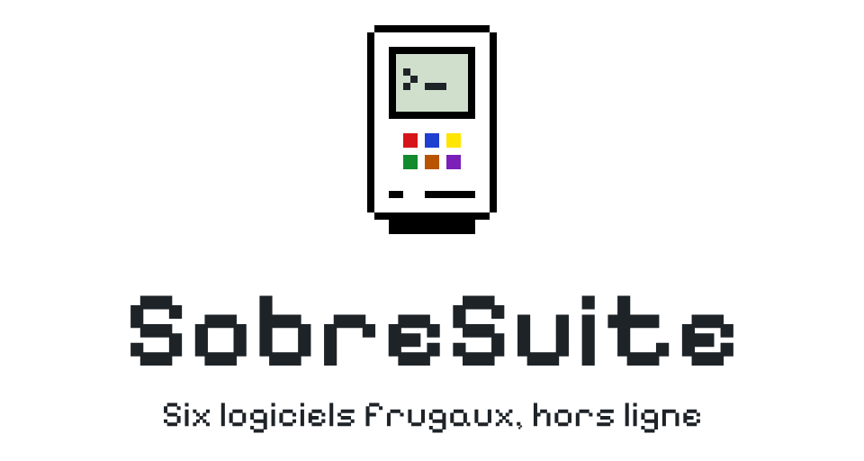
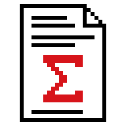
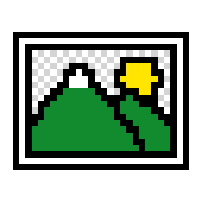
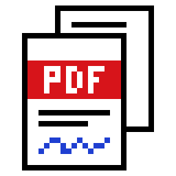
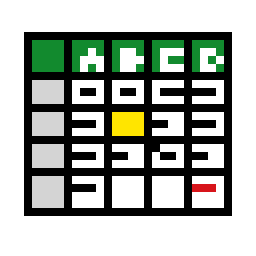
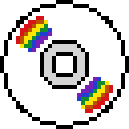
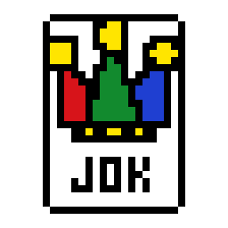

<p align="center"></p>

# SobreSuite

**Des logiciels frugaux, hors ligne, pensés pour aller à l'essentiel.**

👉 **[sobresuite.github.io](https://sobresuite.github.io/)**

Chaque application de la SobreSuite tient dans **un seul fichier HTML**. On l'ouvre dans Firefox ou Chrome, et c'est tout : rien à installer, pas de compte, pas de cloud. Elle fonctionne aussi sans connexion, depuis l'ordinateur ou une clé USB.

## Les applications

| | Application | Rôle | État |
|---|---|---|---|
|  | [SobreTeX](https://sobresuite.github.io/apps/SobreTeX.html) | Écrire en LaTeX, sans le taper | Disponible |
|  | [SobrePiX](https://sobresuite.github.io/apps/SobrePiX.html) | Retouche photo frugale | Disponible |
|  | [SobrePdF](https://sobresuite.github.io/apps/SobrePdF.html) | L'outil PDF du quotidien | Disponible |
|  | SobreTaB | Tableaux simples | Bientôt |
|  | [SobreZiK](https://sobresuite.github.io/apps/SobreZiK.html) | Lecteur de musique frugal | Disponible |
|  | [SobreJoK](https://sobresuite.github.io/apps/SobreJoK.html) | Jeux old school pour les pauses café | Disponible |

- **SobreTeX** — un traitement de texte à l'ancienne, façon Word 5.1, qui écrit le LaTeX à votre place. Pensé pour celles et ceux qui n'en ont jamais écrit une ligne.
- **SobrePiX** — recadrer, faire pivoter, écrire, dessiner, changer la taille (pixels ou centimètres) et tramer façon Mac 1984. Enregistre une copie en JPEG, PNG ou WebP.
- **SobrePdF** — assembler plusieurs PDF, réorganiser les pages, pivoter, extraire, écrire sur la page, remplir les formulaires, placer une signature.
- **SobreTaB** — des tableaux simples, sans usine à gaz. En préparation.
- **SobreZiK** — un lecteur de musique façon lecteur de CD : la liste, la pochette en noir et blanc tramé (sans pochette, un disque qui tourne, avec une étiquette inventée pour chaque album) et une télécommande. MP3, FLAC, OGG, M4A, WAV. Rangez votre dossier de musique à côté du fichier : la liste repart toute seule au lancement suivant. La recherche des pochettes manquantes sur Internet est une option, désactivée par défaut.
- **SobreJoK** — six petits jeux : BiN (ronds et lunes), DeM (démineur), ReX (une couronne par zone), SoL (solitaire), FiL (un fil par toutes les cases) et LuX (éteindre les lumières), avec une grille du jour la même pour tout le monde.

## Les principes

- **Un seul fichier**, qui fonctionne hors ligne.
- **Rien n'est envoyé** : vos fichiers restent sur votre ordinateur.
- **L'original n'est jamais modifié** : on enregistre une copie.
- **Une interface à l'ancienne**, façon Mac des années 80 : barre de menus, fenêtres, dialogues, raccourcis clavier.
- **Huit couleurs franches** communes à toute la suite, et la police Pixelify Sans.

| Couleur | Valeur |
|---|---|
| Noir | `#000000` |
| Blanc | `#FFFFFF` |
| Rouge | `#D7141A` |
| Bleu | `#1F3FD1` |
| Jaune | `#FFE500` |
| Vert | `#128A2E` |
| Orange | `#B85400` |
| Violet | `#7A1FB8` |

## Télécharger la suite

📦 **[SobreSuite.zip](https://sobresuite.github.io/SobreSuite.zip)** : toute la suite dans un seul dossier, pour travailler hors ligne.

1. Décompressez le fichier.
2. Ouvrez `SobreSuite.html` dans Firefox ou Chrome : vous retrouvez le bureau de la suite, et les applications s'ouvrent depuis votre ordinateur, sans connexion.
3. Gardez le dossier entier : les applications sont rangées dans `apps`.

Pour une seule application, enregistrez simplement sa page (Ctrl+S, ou ⌘S sur Mac) : c'est un seul fichier, à garder sur votre ordinateur ou sur une clé USB.

## Organisation du dépôt

Toute la suite tient dans ce seul dépôt, publié par GitHub Pages à l'adresse [sobresuite.github.io](https://sobresuite.github.io/).

```
SobreSuite.github.io/
├── index.html          la page d'accueil : un bureau façon Mac 1 bit
├── README.md           ce fichier
├── SobreSuite.zip      la suite à télécharger
├── apps/
│   ├── SobreTeX.html
│   ├── SobrePiX.html
│   ├── SobrePdF.html
│   ├── SobreZiK.html
│   └── SobreJoK.html
└── logos/
    ├── <app>-logo.svg / .png   logo complet, 960 × 512 (icône, nom, devise)
    ├── <app>-icone.svg         icône seule, 32 × 32
    ├── planche-logos.html      tous les logos en situation
    └── logos-a-coller.txt      chaque logo encodé, prêt pour l'attribut src d'une balise 
```

- Les liens de la page d'accueil vers les applications sont relatifs (`apps/<Nom>.html`) : ils marchent en ligne comme depuis le dossier décompressé.
- `SobreSuite.zip` reprend la même organisation : `SobreSuite/SobreSuite.html` (la page d'accueil) et `SobreSuite/apps/`.
- Pour ajouter une application : déposer `apps/<Nom>.html`, passer `ready:false` à `ready:true` dans la table `APPS` de `index.html`, puis refaire `SobreSuite.zip`.

---

© 2026 Auraponymous · Police Pixelify Sans (SIL Open Font License), retouchée pour la suite.
