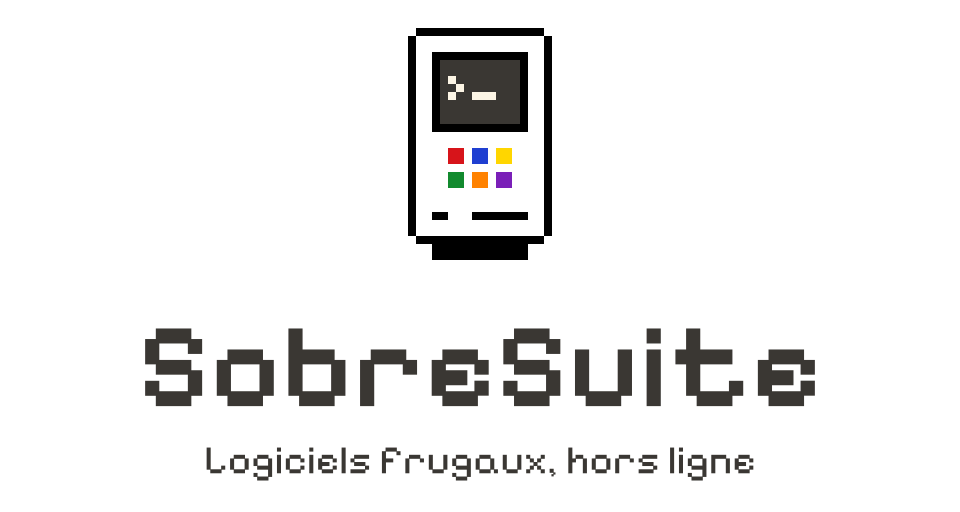
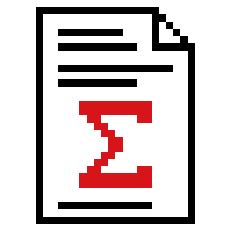
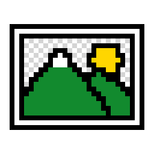
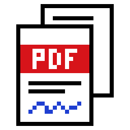
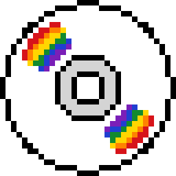
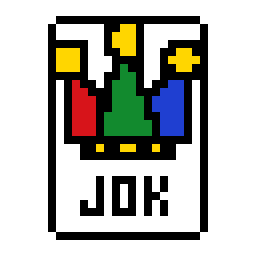

<p align="center"></p>

Chaque application de la SobreSuite tient dans **un seul fichier HTML**. On l'ouvre dans Firefox ou Chrome, et c'est tout : rien à installer, pas de compte, pas de cloud. Elle fonctionne aussi sans connexion, depuis l'ordinateur ou une clé USB.

## Les applications

| | Application | Rôle | État |
|---|---|---|---|
|  | [SobreTeX](https://sobresuite.github.io/apps/SobreTeX.html) | Écrire en LaTeX, sans le taper | Disponible |
|  | [SobrePiX](https://sobresuite.github.io/apps/SobrePiX.html) | Retouche photo frugale | Disponible |
|  | [SobrePdF](https://sobresuite.github.io/apps/SobrePdF.html) | L'outil PDF du quotidien | Disponible |
|  | [SobreDtA](https://sobresuite.github.io/apps/SobreDtA.html) | Tableur et statistiques frugaux | Disponible |
|  | [SobreGeN](https://sobresuite.github.io/apps/SobreGeN.html) | La généalogie sans fioritures | Disponible |
|  | [SobreZiK](https://sobresuite.github.io/apps/SobreZiK.html) | Lecteur de musique frugal | Disponible |
|  | [SobreVoX](https://sobresuite.github.io/apps/SobreVoX.html) | Éditeur audio frugal | Disponible |
|  | [SobreBiT](https://sobresuite.github.io/apps/SobreBiT.html) | Boîte à rythmes frugale | Disponible |
|  | [SobreJoK](https://sobresuite.github.io/apps/SobreJoK.html) | Jeux old school pour les pauses café | Disponible |

- **SobreTeX** — un traitement de texte à l'ancienne, façon Word 5.1, qui écrit le LaTeX à votre place. Pensé pour celles et ceux qui n'en ont jamais écrit une ligne. « Enregistrer sous… » demande ce que vous voulez faire du document (le modifier, l'envoyer, le diffuser, le lire sur une liseuse, le publier, le coller ailleurs) et propose le bon format : LaTeX, Word, OpenDocument, RTF, PDF, EPUB, Markdown ou texte brut, et Typst en mode Geek. Avant d'enregistrer, il signale ce qui ne passera pas (police remplacée, image à remettre, équation en texte brut). Il ouvre aussi les fichiers Markdown et texte. Son mode d'emploi illustré se trouve dans le dossier Document.
- **SobrePiX** — recadrer, faire pivoter, écrire, dessiner, changer la taille (pixels ou centimètres) et tramer façon Mac 1984. Enregistre une copie en JPEG, PNG ou WebP.
- **SobrePdF** — assembler plusieurs PDF, réorganiser les pages, pivoter, extraire, écrire sur la page, remplir les formulaires, placer une signature.
- **SobreDtA** — un tableur et des statistiques dans le même fichier. Mode Feuille : formules en français, tri, filtre, copier-coller avec Excel, ouverture des fichiers CSV et XLSX. Mode Stat : descriptives, tests t, ANOVA (groupes indépendants, mesures répétées, mixte), ANCOVA, corrélations, régressions linéaire et logistique, khi², alpha de Cronbach. Un assistant « Quel test choisir ? » pose les bonnes questions en français clair. Les résultats sortent en tableaux au format APA, avec la phrase à copier et une interprétation en clair ; export vers Word, LaTeX, PDF ou HTML. Pensé pour l'ordinateur.
- **SobreGeN** — un arbre généalogique sans fioritures : on importe un GEDCOM (Geneanet, Heredis, MyHeritage, Gramps…) ou on part de zéro, on corrige, on complète, on valide fiche par fiche, puis on réenregistre le GEDCOM sans rien perdre. Fiche courte, le reste en option (domiciles, déportation, dossier militaire, médailles) ; contrôle des incohérences et des doublons ; arbre d'ascendance, liste triable et carte des lieux ; drapeau du pays de naissance selon les époques. Pensé pour l'ordinateur. Pour placer automatiquement les lieux sur la carte, posez `SobreGeN-lieux.js` à côté de `SobreGeN.html` (facultatif).
- **SobreZiK** — un lecteur de musique façon lecteur de CD : la liste, la pochette en noir et blanc tramé (sans pochette, un disque qui tourne, avec une étiquette inventée pour chaque album) et une télécommande. MP3, FLAC, OGG, M4A, WAV. Rangez votre dossier de musique à côté du fichier : la liste repart toute seule au lancement suivant. La recherche des pochettes manquantes sur Internet est une option, désactivée par défaut.
- **SobreVoX** — un éditeur audio pensé d'abord pour la voix : enregistrer au micro, couper, coller, déplacer sur plusieurs pistes, puis « Préparer la voix » en un clic (souffle réduit, graves coupés, volume égalisé, niveau final en LUFS pour un podcast ou une vidéo) et couper les blancs entre les phrases. Il mixe aussi de la musique : égaliseur, compresseur, écho, réverbération, tempo sans changer la hauteur. Lit MP3, WAV, FLAC, OGG et M4A ; exporte en MP3, WAV ou FLAC. La séance est gardée dans le navigateur, et un projet s'enregistre en fichier `.sobrevox`.
- **SobreBiT** — une boîte à rythmes électro : huit pistes de seize pas, quatre motifs et une chaîne. Tous les sons sont synthétisés (batterie, Space age, Électro), avec des démos pour chaque style ; on peut aussi importer ses propres sons. Effets en direct (filtre, bits, saturation, écho). Exporte en WAV, MP3 ou FLAC, en boucle sans couture, ou une piste par son pour la reprendre dans SobreVoX. Un projet s'enregistre en fichier `.sobrebit`.
- **SobreJoK** — sept petits jeux : BiN (ronds et lunes), DeM (démineur), ReX (une couronne par zone), SoL (solitaire), FiL (un fil par toutes les cases), LuX (éteindre les lumières) et UfO (repousser l'invasion, un jeu d'arcade spatial), avec une grille du jour la même pour tout le monde. SoL prévient quand la donne ne peut plus être gagnée ; UfO se joue au clavier sur ordinateur et au doigt sur téléphone, couché pour jouer en grand.

## Les principes

- **Un seul fichier**, qui fonctionne hors ligne.
- **Rien n'est envoyé** : vos fichiers restent sur votre ordinateur.
- **L'original n'est jamais modifié** : on enregistre une copie.
- **Une interface à l'ancienne**, façon Mac des années 80 : barre de menus, fenêtres, dialogues, raccourcis clavier.
- **Huit couleurs franches** communes à toute la suite, et la police Pixelify Sans.

| Couleur | Valeur |
|---|---|
| Noir | `#000000` |
| Blanc | `#FFFFFF` |
| Rouge | `#D7141A` |
| Bleu | `#1F3FD1` |
| Jaune | `#FFE500` |
| Vert | `#128A2E` |
| Orange | `#B85400` |
| Violet | `#7A1FB8` |

## Télécharger la suite

📦 **[SobreSuite.zip](https://sobresuite.github.io/SobreSuite.zip)** : toute la suite dans un seul dossier, pour travailler hors ligne.

1. Décompressez le fichier.
2. Ouvrez `SobreSuite.html` dans Firefox ou Chrome : vous retrouvez le bureau de la suite. Le dossier **Applications** rassemble les applications, qui s'ouvrent depuis votre ordinateur, sans connexion. Le dossier **Document** rassemble leurs modes d'emploi en PDF (celui de SobreTeX est prêt, les autres suivent).
3. Gardez le dossier entier : les applications sont rangées dans `apps`, les modes d'emploi dans `Documents`.

Pour une seule application, enregistrez simplement sa page (Ctrl+S, ou ⌘S sur Mac) : c'est un seul fichier, à garder sur votre ordinateur ou sur une clé USB.

## Organisation du dépôt

Toute la suite tient dans ce seul dépôt, publié par GitHub Pages à l'adresse [sobresuite.github.io](https://sobresuite.github.io/).

```
SobreSuite.github.io/
├── index.html          la page d'accueil : un bureau façon Mac 1 bit, avec les dossiers Applications et Document
├── README.md           ce fichier
├── SobreSuite.zip      la suite à télécharger
├── apps/
│   ├── SobreTeX.html
│   ├── SobrePiX.html
│   ├── SobrePdF.html
│   ├── SobreDtA.html
│   ├── SobreGeN.html
│   ├── SobreGeN-lieux.js   répertoire des lieux pour la carte de SobreGeN (facultatif)
│   ├── SobreZiK.html
│   ├── SobreVoX.html
│   ├── SobreBiT.html
│   └── SobreJoK.html
├── Documents/          les modes d'emploi en PDF, un par application
│   └── SobreTeX-mode-emploi.pdf
└── logos/
    ├── <app>-logo.svg / .png   logo complet, 960 × 512 (icône, nom, devise)
    ├── <app>-icone.svg         icône seule, 32 × 32
    ├── planche-logos.html      tous les logos en situation
    └── logos-a-coller.txt      chaque logo encodé, prêt pour l'attribut src d'une balise 
```

- Les liens de la page d'accueil vers les applications sont relatifs (`apps/<Nom>.html`) : ils marchent en ligne comme depuis le dossier décompressé.
- `SobreSuite.zip` reprend la même organisation : `SobreSuite/SobreSuite.html` (la page d'accueil), `SobreSuite/apps/` et `SobreSuite/Documents/`.
- Pour ajouter une application : déposer `apps/<Nom>.html`, ajouter son entrée dans la table `APPS` de `index.html` et son icône dans `APP_PX` (le groupe `translate(352 20) scale(8)` de son logo), puis refaire `SobreSuite.zip`.
- Pour ajouter un mode d'emploi : déposer le PDF dans `Documents/` sous le nom `<Nom>-mode-emploi.pdf` (casse exacte, par exemple `SobrePiX-mode-emploi.pdf`), puis ajouter l'identifiant de l'application dans `MANUALS_READY` en tête du script de `index.html` (par exemple `['tex','pix']`), et refaire `SobreSuite.zip`. Il s'ouvre alors depuis le dossier Document.

---

© 2026 Auraponymous · Police Pixelify Sans (SIL Open Font License), retouchée pour la suite.
